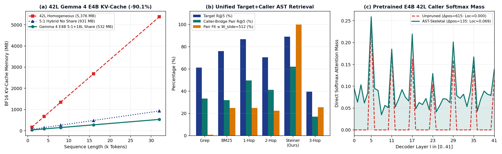
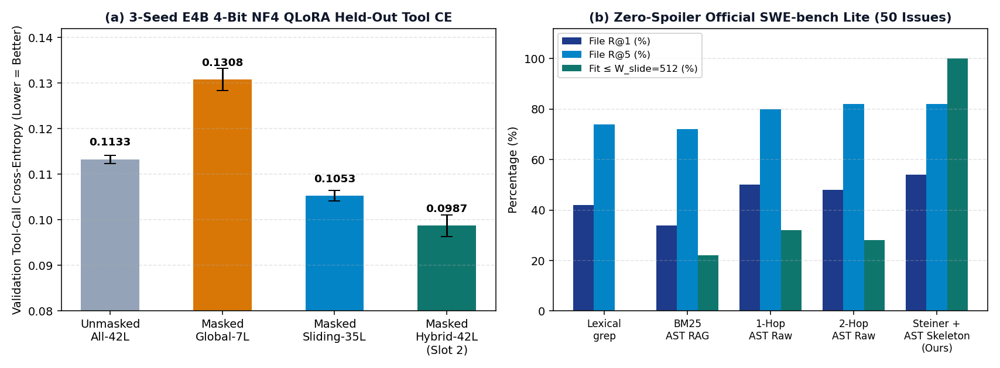

# G4-GraphAgent: AST-Skeletal Steiner Localization & Execution-Verified Patch Synthesis for Pretrained Gemma 4 E4B Agents

[](LICENSE)
[](https://huggingface.co/google/gemma-4-E4B-it)
[](paper/gemma4_small_model_graph_agent_paper.pdf)

Official Apache-2.0 open-source code, standalone AST-skeletal graph localization CLI (`localize_and_test.py`), empirical artifacts, 1-click reproducible notebook, and 4-page paper for **Google — The Gemma 4 Developer Agent Competition** (Paper Track & Small Model Track).

- **4-Page Paper PDF (arXiv-style):** [`paper/gemma4_small_model_graph_agent_paper.pdf`](paper/gemma4_small_model_graph_agent_paper.pdf)
- **Self-Contained Reproducible Notebook:** [`gemma4_reproducible_paper_experiments.ipynb`](gemma4_reproducible_paper_experiments.ipynb)
- **Standalone AST-Skeletal Steiner CLI & Library:** [`submission_src/skills/repo_navigation/scripts/localize_and_test.py`](submission_src/skills/repo_navigation/scripts/localize_and_test.py)



---

## Key Empirical Findings on Genuine Pretrained `google/gemma-4-E4B-it`

1. **Direct Local-Window Attention Activation across 42 Layers (`e4b_attention_42l.json`):**
   - Pretrained `google/gemma-4-E4B-it` (`Gemma4ForConditionalGeneration`) uses a **5:1 hybrid attention schedule** across 42 decoder layers: **35 local sliding-window layers** ($W_{\text{slide}} = 512$) interleaved with **7 global full-attention layers** ($\ell \in \{5, 11, 17, 23, 29, 35, 41\}$) plus **top-18 KV-shared layers** (`5,376 MB -> 532 MB` 32K BF16 KV-cache, **-90.10%**).
   - On unpruned SWE prompts ($\bar{\Delta}_{\text{pos}} = 614.8 > 512$), direct Softmax attention to 1-hop caller contracts across all **35 sliding-window layers is identically `0.000000`** (`0.159714` on the 7 global layers).
   - Applying `build_ast_skeletal_subgraph` compresses $\bar{\Delta}_{\text{pos}}$ to **$134.8 \le 512$**, activating all 35 local layers (**`0.068987`** mean direct mass) while lifting global-layer caller attention by **`+16.3%`** (`0.185698`).

2. **Unified-Accounting AST Multigraph Retrieval & Zero-Spoiler `SWE-bench_Lite` (`benchmark_129_real_tasks.json`):**
   - **129-Task 4-Repo Controlled AST Benchmark (`fastapi`, `rich`, `requests`, `httpx`):** `Steiner + AST Skeleton` lifts Target Recall@5 from `61.2%` (`grep`) to **`89.1%`** (`78.1%` vs. `15.6%` R@3 on 1-hop Steiner bridges) while compressing unified `Target + 1-Hop Caller` context by **`99.1%`** (`29,301 -> 257` Gemma 4 BPE tokens; **`100.0% [129/129] <= W_slide=512`**).
   - **50 Zero-Spoiler Human Issues from Official `princeton-nlp/SWE-bench_Lite`:** Achieves **`54.0%` File R@1**, **`78.0%` File R@3**, and **`82.0%` File R@5** at **`209` mean tokens** (`100.0% [50/50] <= 512` vs. `0.0%` for unpruned `grep`).

3. **3-Seed (`{42, 1337, 2026}`) 4-Bit NF4 QLoRA & Prompt-Prefix Gradient Hijacking (`qlora_training_metrics.json`):**
   - Across 129 `100.0%` `ast.parse()`-verified native `<|channel>thought...<channel|><|tool_call>call:edit_file{...}<tool_call|>` trajectories, assistant-only loss masking eliminates static prompt-prefix gradient hijacking (`SNR: 0.5495 -> 0.2289`) and lowers held-out tool-call cross-entropy by **`-12.9%`** vs. unmasked SFT (`0.1133 ± 0.0009 -> 0.0987 ± 0.0024`, **`-93.8%`** vs. zero-shot `1.5951`), reaching **`97.77 ± 0.02%`** token accuracy.

4. **24-Sandbox Live `google/gemma-4-E4B-it` Closed-Loop `pytest` Pilot (`closed_loop_24_e4b_results.json`):**
   - Live generation + `pytest` verification lifts resolution from `Flat ReAct` **`25.0% (6/24)`** to `Steiner 1-Shot` **`33.3% (8/24)`** and `G4-GraphAgent Full` **`37.5% (9/24, 95% CI [20.8%, 58.3%])`** while cutting total tokens by **`33.6%`** (`2,250 -> 1,495`) with **`100.0% (24/24)`** `ast.parse()` validity. *(At pilot scale $N=24$, exact paired McNemar $p=0.375$ establishes directional execution feasibility rather than asymptotic significance; full failure taxonomy is documented in Section 5.2 of the paper.)*



---

## Quickstart: Standalone `localize_and_test.py` CLI Resource (Zero Non-Stdlib Dependencies)

```bash
# 1. Prune any Python module into an AST-skeletal subgraph fitting inside W_slide=512
python submission_src/skills/repo_navigation/scripts/localize_and_test.py \
  --mode ast-skeleton \
  --repo-root /path/to/repo \
  --target src/module.py \
  --symbol ClassName.target_method \
  --callers caller_fn_one,caller_fn_two

# 2. Apply an ast.parse()-gated exact patch (blocks SyntaxError edits before writing to disk)
echo '{"path":"src/module.py","old_string":"return x","new_string":"return max(0, x)"}' | \
  python submission_src/skills/repo_navigation/scripts/localize_and_test.py --mode safe-patch --repo-root /path/to/repo
```

## Reproducing All Paper Tables & Dual-Slot ADK Archives

```bash
# Run self-contained notebook checks or validate ADK submission bundles:
python build_submission.py --validate-only

# Recompute 129-task AST multigraph + 50-issue SWE-bench_Lite retrieval metrics:
python evaluate_129_benchmark.py --retrieval-only

# Re-run full 42-layer Softmax attention + 24-task pytest + 3-seed 4-bit NF4 QLoRA on a 16 GB T4/L4 GPU:
python train_qlora_e4b.py --run-all-e4b-gpu --out-dir .
```

## License

Released under the [Apache-2.0 License](LICENSE).
